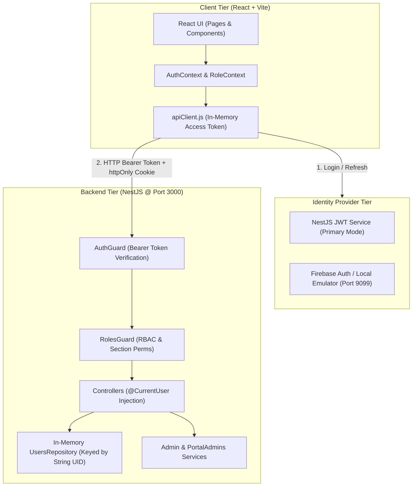
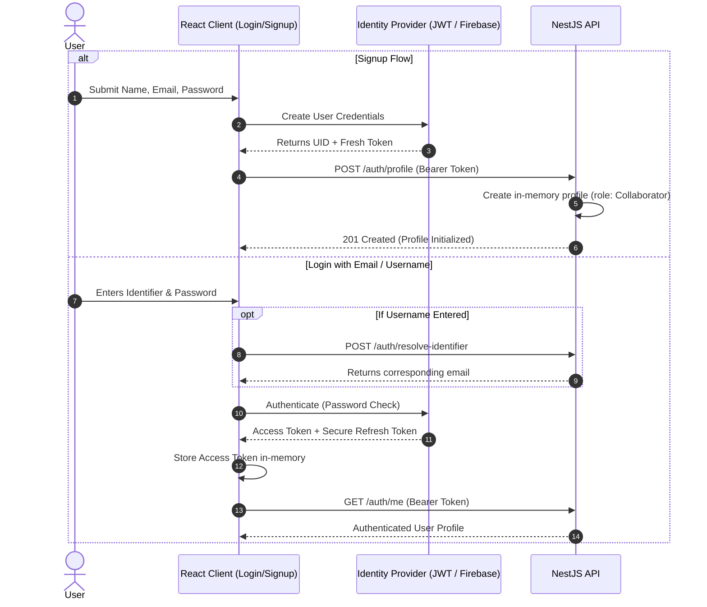
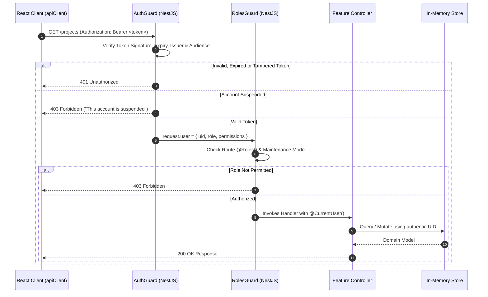
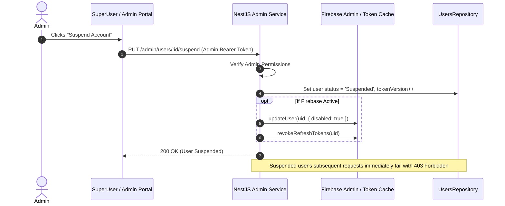

# TeamForge Authentication & RBAC Architecture Guide

## 1. 60-Second Viva Pitch
> "In this project, we transitioned TeamForge from an insecure, spoofable header-based identity model (`x-user-id`, `x-user-role`, `x-user-email`) to an enterprise-grade cryptographic authentication and Role-Based Access Control (RBAC) architecture supporting both **JWT (HS256 with Refresh Token Rotation)** and **Firebase Authentication with Custom Claims**, with a seamless fallback to legacy headers.
>
> In our secure modes, identity and permissions are cryptographically signed and non-forgeable. Client headers are completely disregarded; identity is extracted exclusively on the server from verified tokens. We implemented refresh token rotation with automated reuse/theft detection, real-time suspension enforcement, section-level permissions for portal administrators, and seamless offline emulation via the Firebase Local Emulator Suite.
>
> Importantly, our architecture preserves all existing in-memory stores and platform business rules—such as mentor locks, project completion guarantees, and platform maintenance mode—without storing sensitive credentials in git or exposing secrets."

---

## 2. System Architecture



---

## 3. Sequence Flow Diagrams

### 3.1 Signup & Login Flow


### 3.2 Protected API Call & RBAC Verification


### 3.3 Dynamic Role Switch
```mermaid
sequenceDiagram
    autonumber
    actor User
    participant Nav as Navbar Role Switcher
    participant RoleCtx as RoleContext
    participant API as NestJS /users/switch-role
    participant Store as In-Memory UsersRepository

    User->>Nav: Selects "Project Owner" or "Mentor"
    Nav->>RoleCtx: switchRole(newRole)
    RoleCtx->>API: POST /users/switch-role { role: newRole }
    API->>API: Validate Eligibility (Mentor requires approval; Admin forbidden)
    alt Unauthorized Role
        API-->>RoleCtx: 403 Forbidden
    else Eligible
        API->>Store: Update User's Active Role
        API-->>RoleCtx: 200 OK + Updated Claims / Access Token
        RoleCtx->>RoleCtx: Force Token Refresh & Update State
        Nav-->>User: Active Role Switched Successfully
    end
```

### 3.4 Admin Account Suspension


---

## 4. Key Architectural Decisions

1. **Why Custom Claims & Token Claims for Role?**
   - In legacy mode, roles were passed via `x-user-role`, which any client or curl command could forge.
   - Putting `role` inside cryptographically signed claims ensures that role identity is authenticated at the cryptographic boundary. An attacker cannot elevate their role without invalidating the token signature.

2. **Why Verify Tokens on Every Single Call?**
   - Token verification (`verifyIdToken` in Firebase, HMAC-SHA256 signature and expiration check in JWT) eliminates session hijacking and forgery.
   - We check `checkRevoked` in production and compare `tv` (token version) against the user's active version, allowing instant revocation when accounts are suspended or passwords changed.

3. **Why Keep the In-Memory Stores?**
   - The project requirements mandated preserving the existing in-memory repository architecture.
   - We adapted the in-memory keys from numeric IDs to string UIDs (e.g. `'1'`, `'2'`, `'u-owner'`), maintaining full compatibility with seeded demo accounts while supporting dynamic identity generation.

4. **Why Support the Firebase Local Emulator Suite?**
   - Allows students and evaluators to run, test, and defend the system completely offline without an active internet connection, without credit card requirements, and without cloud costs.
   - In emulator mode, `FIREBASE_AUTH_EMULATOR_HOST=localhost:9099` allows `firebase-admin` to initialize without requiring a private service account key.

5. **Why Feature Flag `AUTH_MODE` and `VITE_AUTH_MODE`?**
   - Supports 3 runtime modes (`jwt`, `firebase`, `legacy`) through a single unified `AuthStrategy` abstraction.
   - Enables zero-risk rollback to legacy header authentication if required during evaluation, while making modern signed JWT authentication the robust default.

---

## 5. Security Comparison Table

| Threat / Attack Vector | Header-based (Legacy) | Firebase / JWT Auth | How We Prevent It |
| :--- | :--- | :--- | :--- |
| **Header Spoofing** | Vulnerable: `x-user-role: admin` grants full control | Immune: Headers are completely ignored | Identity and roles are extracted strictly from verified token claims |
| **Token Tampering** | N/A (no signature checked) | Blocked: Signature mismatch triggers 401 | HMAC-SHA256 / RSA cryptographic verification detects any modified bytes |
| **Expired Identity** | Vulnerable: headers have no TTL | Immune: 15-minute access token expiry | Expired tokens are rejected with 401; silent refresh requires valid refresh session |
| **Offline Operation** | Works offline | Works offline | Fully supported offline via JWT mode and Firebase Auth Emulator |
| **Role Escalation** | Vulnerable: any role string accepted | Blocked: Claims sealed in token | Role changes require authenticated `/users/switch-role` with business validation |
| **Account Enumeration** | Leaked user existence via custom errors | Generic error responses | Login returns generic failure message: "Invalid credentials" |
| **Revoked Session Bypass** | Vulnerable: no session revocation | Blocked: tokenVersion and revocation checks | Bumping `tokenVersion` or setting `disabled: true` immediately terminates active sessions |
| **Replay / Token Theft** | Replayable indefinitely | Detected & Blocked | Refresh token rotation revokes all sessions if a used refresh token is re-submitted |

---

## 6. Viva Q&A (12 Anticipated Questions & Strong Answers)

### Q1: Why did you migrate away from custom headers like `x-user-id` and `x-user-role`?
**Answer:** Custom headers provide zero integrity or authenticity. Any HTTP client, proxy, or browser extension can spoof `x-user-role: Administrator` or `x-user-id: 1` to impersonate any user or administrator. Migrating to signed tokens guarantees that identity is cryptographically proven and non-forgeable.

### Q2: How does the server know which authentication mode to use?
**Answer:** We implemented the **Strategy Pattern** with an `AuthStrategyResolver`. Based on the `AUTH_MODE` environment variable (`jwt`, `firebase`, or `legacy`), the resolver returns the appropriate strategy implementing a common `AuthStrategy` interface, keeping our business code completely decoupled from the provider.

### Q3: Where are access tokens stored in the browser, and why?
**Answer:** Access tokens are stored exclusively **in-memory** in JavaScript (`inMemoryAccessToken`). They are never persisted to `localStorage` or `sessionStorage`, which completely eliminates token exfiltration through Cross-Site Scripting (XSS). Long-lived refresh tokens are stored in `httpOnly`, `SameSite=Lax` cookies that JavaScript cannot access.

### Q4: What happens when a user's access token expires?
**Answer:** When an API request encounters a 401 Unauthorized, `apiClient.js` automatically issues a single silent refresh request (`POST /auth/refresh`) using the `httpOnly` cookie. If successful, it stores the new access token and retries the original request transparently without interrupting the user.

### Q5: What is Refresh Token Rotation and Theft Detection?
**Answer:** Each time a refresh token is used, it is invalidated and replaced with a newly generated one. If an attacker intercepts and attempts to reuse an old refresh token, our server detects the replay attempt, treats it as token theft, and immediately revokes all active sessions for that user account.

### Q6: How is immediate account suspension enforced?
**Answer:** When an administrator suspends a user, the user's status is updated to `Suspended` and their `tokenVersion` is incremented. In Firebase mode, the account is disabled and refresh tokens revoked. On every authenticated request, `AuthGuard` verifies that the user is not suspended and that the token version matches, rejecting suspended users with a 403 Forbidden even if their token has not yet expired.

### Q7: How does role-based authorization work on the back end?
**Answer:** Routes are decorated with `@Roles('Project Owner', 'Administrator')`. The global `RolesGuard` extracts the authenticated role from `request.user.role` (populated by `AuthGuard`) and validates it against the permitted roles. Super User permissions override standard role checks, and portal admins are additionally restricted by section permissions.

### Q8: Can a regular user switch their role to Admin or Super User?
**Answer:** No. The `POST /users/switch-role` endpoint explicitly restricts switchable roles to `Collaborator`, `Project Owner`, and `Mentor`. Administrative roles (`Admin`, `SuperUser`) can never be self-assigned; attempts to do so are rejected with HTTP 403 Forbidden.

### Q9: What business rules did you preserve during the authentication refactoring?
**Answer:** All core business constraints were preserved: mentor lock (a mentor cannot leave or be removed once a project begins), project completion lock, username and email uniqueness (HTTP 409 Conflict), mentor application approval prerequisites, platform maintenance mode (HTTP 503 for non-admins), and request rate limiting.

### Q10: How does the frontend handle login by username instead of email?
**Answer:** Firebase Auth requires an email. To support username login, we added a secure, rate-limited `/auth/resolve-identifier` endpoint that takes a username and returns only the corresponding email for sign-in without revealing sensitive user data.

### Q11: How do you prevent account enumeration on login and password reset?
**Answer:** Login attempts return generic messages ("Invalid email or password") regardless of whether the user exists or the password was incorrect. Password reset requests always display the same confirmation notice ("If an account exists, a reset link has been dispatched") to prevent attackers from determining which email addresses are registered.

### Q12: How do you run this project completely offline?
**Answer:** In JWT mode, the backend generates and verifies tokens locally with zero external network calls. In Firebase mode, the system runs against the Firebase Local Emulator Suite (Auth on port 9099, UI on port 4000) using dummy project IDs and credentials.
