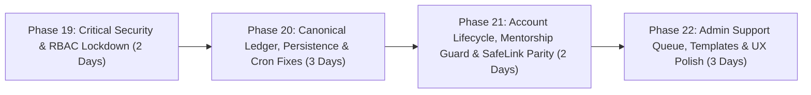

# TeamForge Architectural & Policy Audit: What's Done, What's Left & New Findings (Post-Phase 18)

**Date**: November 11, 2026  
**Auditor**: Antigravity AI  
**Scope**: Full Re-Audit of React + Vite Frontend (`React-Implementation/React-Implementation/src/`) and NestJS In-Memory Backend (`back-end/src/`) across Policies **Phases 1–18**  

---

## Executive Summary & Scorecard

Since the baseline Phase 5 audit (which cataloged 42 findings), **Phases 6 through 18** were implemented across security hardening, job scheduling, finality locks, escrow safety, JSON snapshots, project health telemetry, stuck-project recovery, task review workflows, mentor lifecycle, collaboration UX, trust & safety, disputes/accountability, and GDPR privacy/notifications.

A fresh source-level audit of the live codebase verified the status of all **42 original findings** AND uncovered **18 new concrete findings** (12 unpatched bugs/security bypasses, 2 policy gaps, and 4 high-impact new feature ideas) for **Phases 19–22**.

### Key Audit Metrics
- **Original Baseline (42 Findings)**:
  - **DONE**: **38 / 42** (90.5%) verified implemented across Phases 6–18
  - **PARTIAL (Remaining Gaps)**: **4 / 42** (`SEC-02`, `SEC-04`, `GAM-01`, `NOT-01`)
  - **LEFT UNTOUCHED**: **0 / 42**
- **New Post-Phase 18 Findings Discovered Today (+18 Findings)**:
  - **Confirmed Bugs (`BUG`)**: **12** (4 Critical, 8 High)
  - **Policy & Enforcement Gaps (`GAP`)**: **2** (2 Medium)
  - **New High-Impact Product Ideas (`IDEA`)**: **4** (1 High, 3 Medium)
- **Combined Catalog**: **60 Audited Findings** (38 Resolved, 4 Partial, 18 New Open Items)

### 5-Line Executive Summary
1. **Huge Progress (38/42 Done)**: Chat guards (`SEC-01`), `@Cron` job runner (`JOB-01`), escrow closure refunds (`FIN-01`), report/appeal finality (`MOD-01`/`MOD-02`), zombie breaker (`JOB-02`), ghost mentor release (`MEN-01`), and snapshot durability are live and tested. Project Health (`PRJ-02`) was completely retired in Phase 1.
2. **4 Partial Original Items Remaining**: `<SafeLink>` is only on `TaskCard` and `profile.jsx`—**6 raw `<a href>` instances** remain in `ProjectCard`, `AdminMentorApps`, `CollaboratorWorkspace`, and `OwnedWorkspace` (`SEC-02`/`SEC-04`); project completion badges still lack a minimum duration (`GAM-01`); immediate notification mode still floods batch task releases (`NOT-01`).
3. **Top New Critical Security Bugs**: `@Public() POST /users` lets anonymous callers create `Super User` accounts and `@Public() POST /users/login` logs in **without a password** if omitted (`SEC-05`); `PATCH /users/:id` allows mass assignment of `role`, `status`, `emailVerified`, & `xp`, while `DELETE /users/:id` has zero ownership check (`SEC-06`).
4. **Top New Critical Data & Durability Bugs**: A split-brain exists between `ReputationService` and `GamificationRepository`—`backfillStartupSeedUsers()` double-counts seed reputation on boot (`87 -> 174` for Arjun) while task approvals (`+8`) and completion badges (`+15`) omit `ReputationService` (`DAT-01`); `PersistenceService` omits `EscrowService`, `PlatformConfigService`, `PortalAdminsService`, `MentorApplicationsService`, and `DemoUpiProvider` (`DUR-01`).
5. **Top New Operational & Feature Ideas**: Exclude `Draft`/`deletedAt` projects from cron penalties (`PRJ-07`), complete account deletion task/slot/CV cleanup (`PRJ-08`), add mentor time-slot overlap checks (`MEN-06`), build the missing **Admin Support & Closure Ticket Inbox UI** (`ADM-03`), add starter task templates (`PRJ-09`), and add mentor calendar slot pickers (`MEN-07`).

---

## 1. Status of Original 42 Audit Findings (What's Done vs What's Left)

Every item from the Phase 5 baseline audit was re-verified against the current source tree (`back-end/src/` and `React-Implementation/React-Implementation/src/`).

| ID | Original Finding | Original Type | Current Status | Phase | Verified Implementation / What Remains |
|---|---|---|---|---|---|
| **SEC-01** | Private Chat History Exfiltration | BUG | **DONE** | Phase 6 | `@CurrentUser()` + `CHAT_MEMBERSHIP_REQUIRED` (403) + `CHAT_ACCESS_DENIED` audit log in `communication.controller.ts` & `communication.service.ts`; 403 locked UI in `ChatBox.jsx`. |
| **JOB-01** | Hourly Background Jobs Never Trigger | BUG | **DONE** | Phase 7 | `@Cron(CronExpression.EVERY_HOUR)` in `jobs.service.ts`, `JobRunsService` lock & log, `POST /admin/jobs/tick` & `ScheduledJobsPanel.jsx`. |
| **FIN-01** | Escrow Refund Ignores `pending` & `payment_pending` | BUG | **DONE** | Phase 9 | `handleProjectClosed` in `mentor-marketplace.service.ts` covers `payment_pending`, `escrow_funded`, `active`, `payout_pending` idempotently. |
| **MOD-01** | Duplicate Moderation Report Actioning | BUG | **DONE** | Phase 8 | `reports.service.ts` throws `409 REPORT_ALREADY_ACTIONED` on terminal statuses (`Resolved`/`Dismissed`); disabled buttons in `AdminReports.jsx`. |
| **MOD-02** | Appeal Decision Reversal / Inversion | BUG | **DONE** | Phase 8 | `appeals.service.ts` enforces `appeal.status === 'pending'` or throws `409 APPEAL_ALREADY_DECIDED`. |
| **PRJ-01** | Zero-Task Instant Project Completion | BUG | **DONE** | Phase 8 | `projects.service.ts` blocks 0-task completion with `400 PROJECT_NO_TASKS`; UI disabled in `OwnedWorkspace.jsx`. |
| **SEC-02** | Proof & Profile Link XSS (`javascript:`) | BUG | **PARTIAL** | Phase 6 | **Done**: Server `assertSafeHttpUrl` blocks `javascript:`/`data:`/`file:` on task proofs, finalLink, user LinkedIn/portfolio/website & mentor apps (`400 INVALID_URL`). **Left**: Raw `<a href>` still exists in `ProjectCard.jsx:250`, `AdminMentorApps.jsx:534`, `CollaboratorWorkspace.jsx:587`, `OwnedWorkspace.jsx:1377, 2116, 2214`; avatar SVG XSS open (`file-upload.middleware.ts:67`). |
| **COM-01** | Orphaned Seed Notifications Store | BUG | **DONE** | Phase 8 | Consolidated into `NotificationsService`; duplicate store removed from `CommunicationRepository`. |
| **SEC-03** | DigiLocker Substring Name Match Bypass | BUG | **DONE** | Phase 6 | Token-set equality & honorific stripping (`isDigiLockerNameMatch`) in `digilocker-sandbox.provider.ts`; substring matches rejected. |
| **COL-01** | Join Approval Concurrency Overfill | BUG | **DONE** | Phase 8 | Serialized per-project promise queue (`runInProjectQueue`) in `join-requests.service.ts` re-evaluates capacity under lock. |
| **PRJ-02** | Owner "Why Nobody Applies" Health Panel | IDEA | **REMOVED** | Phase 1 | Completely removed in Phase 1 (replaced with direct workspace actions and owner response time). |
| **JOB-02** | Zombie Project Infinite Pause Loop | GAP | **DONE** | Phase 12 | `zombieProjectBreaker` in `jobs.service.ts` closes paused projects after 48h grace window (`pausedAt`) and closes pending requests as `system_closed`. |
| **MEN-01** | Ghost Mentor Permanent Workspace Lock | GAP | **DONE** | Phase 14 | `POST /projects/:id/mentor/abandonment-review`, 48h confirm window, automatic release & refund (`mentorAbandonmentReleaser`). |
| **TSK-01** | Silent Task Rejection Without Reason | GAP | **DONE** | Phase 13 | Mandatory 10–500 char reason in `POST /tasks/:id/review` (`rejectTask`), stored `rejectionHistory[]`, displayed in `TaskCard.jsx`. |
| **TSK-02** | In-Review Tasks Lost on Collaborator Leave | GAP | **DONE** | Phase 13 | Shared `TasksService.releaseMemberTasksOnDeparture` preserves `In Review` tasks & proofs across leave, removal, and suspension. |
| **MEN-02** | Unlimited Mentor Re-Applications | GAP | **DONE** | Phase 14 | 14-day cooldown (`REAPPLY_COOLDOWN`) enforced via `rejectedAt` & configurable `mentorReapplyCooldownDays`. |
| **TSK-03** | Abandoned Task In-Review Limbo | GAP | **DONE** | Phase 13 | `reviewDeadlineJob` sends Day-3 owner reminder and auto-approves at Day 7 via `approveTask` (skips unsafe proof links). |
| **PRJ-03** | Extending Project Deadline Without Shifting Tasks | GAP | **DONE** | Phase 11 | `PATCH /projects/:id/deadline` supports `shiftTasks: true`, shifting open tasks by `diffDays` + `OwnedWorkspace.jsx` checkbox. |
| **COL-02** | Early Withdrawal Burns Request Slot | GAP | **DONE** | Phase 12 | `JoinRequestsService.withdrawRequest` refunds quota slot (`countedTowardLimit = false`) if `< 2h` and before owner `viewedAt`. |
| **AUT-01** | Social Incomplete Profile URL Bypass | BUG | **DONE** | Ph 5 & 6 | `AuthGuard` returns `403 PROFILE_INCOMPLETE` on all non-whitelisted endpoints; React `ProtectedRoute` forces `/complete-profile`. |
| **AUT-02** | Phone OTP Brute-Force Vulnerability | GAP | **DONE** | Phase 16 | `UsersService` voids OTP and enforces 15-min lockout after 5 wrong attempts (`429 OTP_LOCKED`) with Settings countdown. |
| **MOD-03** | Self-Report Bypass via Direct API | GAP | **DONE** | Phase 6 | `ReportsService.createReport` returns `400 CANNOT_REPORT_SELF`; `help.jsx` filters current user from search dropdown. |
| **GAM-01** | Instant Dummy-Task Completion Badge Farm | GAP | **PARTIAL** | Phase 8 | **Done**: `COMPLETION_BADGE_MIN_TASKS = 3` enforced in `gamification.service.ts:238`. **Left**: Zero minimum project age/duration check (can create/approve 3 tasks & finish in <60s for `+250 XP / +15 Rep`); also writes only to `GamificationRepository`, never `ReputationService`. |
| **REP-01** | User Search Ranking & Highlighting | IDEA | **DONE** | Phase 15 | `UsersService.searchUsers` ranks exact username -> prefix -> name -> substring; `<HighlightMatch>` highlights UI dropdowns. |
| **MEN-03** | Mentor Booking Date Outside Project Window | GAP | **DONE** | Phase 9 | `bookSession` validates future clock time and `<= project.dueDate`, throwing `400 BOOKING_OUTSIDE_WINDOW`. |
| **PRJ-04** | Export / Clone Closed Project Artifacts | IDEA | **DONE** | Phase 15 | `GET /projects/:id/export.md` downloads spec/task Markdown; `POST /projects/:id/clone` creates isolated `Draft`. |
| **COM-02** | Global Navbar Unread Chat Badge | IDEA | **DONE** | Phase 15 | `GET /communication/unread`, `POST /communication/projects/:id/read`, `navbar.jsx` badge capped at `99+`. |
| **TSK-04** | Unannounced Task Drop Before Deadline | GAP | **DONE** | Phase 13 | `POST /tasks/:id/unassign` enforces mandatory 10–300 char reason within `< 24h` of `dueDate` and notifies owner. |
| **COL-03** | Rejection Notification Suggests Similar Projects | IDEA | **DONE** | Phase 15 | `computeSuggestedProjects` attaches up to 3 skill-matched open projects to rejection notifications & `AppliedProjects.jsx`. |
| **ADM-01** | Admin Project Details Escrow Breakdown | GAP | **DONE** | Phase 17 | `GET /admin/projects/:id/escrow` & `AdminProjectDetails.jsx` "Escrow & Financials" tab with dispute rulings. |
| **MOD-04** | 90-Day Good Standing Warning Decay | IDEA | **DONE** | Phase 17 | `warningDecay` (Job 14) expires clean warnings older than 90 days into `'expired'` status (retaining history). |
| **MEN-04** | Mentor Max Concurrent Mentees Limit | IDEA | **DONE** | Phase 14 | `maxActiveMentees` (1–10, default 3) enforced on booking (`409 MENTOR_AT_CAPACITY`) & configured in `MyMentorProfile.jsx`. |
| **PRJ-05** | Team Capacity Reduction Orphan Risk | GAP | **DONE** | Phase 11 | `ProjectsService.update` blocks reducing `teamSize` below current collaborators (`409 TEAM_SIZE_BELOW_MEMBERS`). |
| **JOB-03** | Admin Scheduled Jobs Heartbeat & Monitor UI | IDEA | **DONE** | Phase 7 | `GET /admin/jobs/runs`, `GET /admin/jobs/runs/:id`, `ScheduledJobsPanel.jsx` run table & detail drawer. |
| **TSK-05** | Task Due Date Editable by Collaborators | GAP | **DONE** | Phase 13 | Role field whitelist on `PATCH /tasks/:id` throws `403 FORBIDDEN_FIELD` if non-owner sends `dueDate` or structural fields. |
| **COL-04** | Direct Collaborator Invite via Username | IDEA | **DONE** | Phase 15 | `ProjectInvitesService`, `InvitesController`, 7-day expiry job (`projectInviteExpirer`), UI in `OwnedWorkspace.jsx`. |
| **MEN-05** | Payment Expiry Recovery & Book Again | GAP | **DONE** | Phase 9 | 30-min `expirePendingPayments` job, `Idempotency-Key` payment cache, and `"Book again"` UI banner in `MentorsDirectory.jsx`. |
| **GAM-02** | Reputation Ledger Pagination & Filter | GAP | **DONE** | Phase 10 | `GET /users/me/reputation` & `GET /admin/users/:id/reputation` with page/limit/type filtering & UI controls. |
| **ADM-02** | Audit Log CSV/JSON Export | IDEA | **DONE** | Phase 17 | `GET /admin/audit/export` with date/actor/action filters, 10k cap, formula-injection sanitization & modal in `AuditLog.jsx`. |
| **SEC-04** | Outbound External Link Confirmation Modal | GAP | **PARTIAL** | Phase 6 | **Done**: `SafeLink.jsx` shows domain + full URL warning dialog on `TaskCard.jsx` & `profile.jsx`. **Left**: External links in `ProjectCard.jsx:250`, `AdminMentorApps.jsx:532`, `CollaboratorWorkspace.jsx:587`, and `OwnedWorkspace.jsx:1377, 2116, 2214` bypass `<SafeLink>` completely. |
| **NOT-01** | Batch Notification Flooding Control | IDEA | **PARTIAL** | Phase 18 | **Done**: `DigestService` merges duplicate `type + target` notifications into `"N tasks released"` summaries when `digestEnabled: true`. **Left**: Users with `digestEnabled: false` still get N separate alerts during synchronous batch task releases/closures. |
| **PRJ-06** | Project Soft Deletion & Restore Tombstone | GAP | **DONE** | Phase 18 | `DELETE /projects/:id` sets `deletedAt`/`deletedBy` (`PROJECT_HAS_ACTIVE_ESCROW` protected); 30-day admin restore (`POST /admin/projects/:id/restore`). |

---

## 2. +18 NEW Findings & Ideas Discovered in Post-Phase 18 Code Audit

Every finding below was verified directly in the current codebase (`back-end/src` and `React-Implementation/React-Implementation/src`) on November 11, 2026.

| ID | Area | Scenario | Type | Evidence (Exact File & Line) | Severity | Impact & Exploit / Gap | Proposed Rule & Fix | Effort | Risk |
|---|---|---|---|---|---|---|---|---|---|
| **SEC-05** | Auth & Users | Unauthenticated Privileged User Creation & Passwordless Login Bypass | **BUG** | `back-end/src/users/users.controller.ts:48-62`; `create-user.dto.ts:30-32, 80-83`; `users.service.ts:150-192, 523-583` | **Critical** | `@Public() POST /users` lets anonymous callers set `role: "Super User"` / `"Administrator"` and `emailVerified: true`; `@Public() POST /users/login` skips password checks completely when `credentials.password` is omitted (`line 180`), returning full PII & allowing account enumeration. | Lock `POST /users` behind `@Roles('superuser')` (public signups use `POST /auth/signup` only); require non-empty password + rate limit on `/users/login` or disable when `AUTH_MODE !== 'legacy'`. | **S** | Low |
| **SEC-06** | Auth & RBAC | Mass Assignment Privilege Escalation (`PATCH /users/:id`) & Unscoped Delete (`DELETE /users/:id`) | **BUG** | `back-end/src/users/dto/update-user.dto.ts:4-7`; `users.controller.ts:508-542`; `users.service.ts:585-695` | **Critical** | `UpdateUserDto extends PartialType(CreateUserDto)` lets a signed-in Collaborator `PATCH` their own `role` to `Super User`, set `emailVerified: true`, alter `status`, inflate `profile.xp`, or change `email` without resetting `emailVerified = false`. Worse, `DELETE /users/:id` allows `@Roles(..., 'Collaborator', ...)` with **zero** ownership check—any user can delete admins or bypass obligations! | Create explicit safe `SelfUpdateUserDto` (whitelist bio, name, skills, university, linkedIn, portfolio, website); reset `emailVerified = false` on email change; restrict `DELETE /users/:id` to `@Roles('superuser')` only. | **S** | Low |
| **DAT-01** | Reputation & XP | Dual Reputation Ledger Split-Brain & Startup Seed Double-Counting | **BUG** | `back-end/src/moderation/reputation.service.ts:20-50, 158-174`; `gamification.service.ts:237-262`; `tasks.service.ts:692`; `users.service.ts:322, 567, 807` | **Critical** | `ReputationService.backfillStartupSeedUsers()` writes seed rep into `GamificationRepository` on startup even though `GamificationRepository.initSeeds()` already seeded those exact entries—**doubling** seeded users' rep (e.g., Arjun `87 -> 174` on Leaderboard!). Meanwhile, `UsersService` writes signup `+100`, `TasksService` writes `+8`, and `ProjectsService` writes completion `+15` ONLY to `GamificationRepository`, leaving `ReputationService` / `GET /users/me/reputation` completely stale (`0` rep on new accounts!). | Unify into **one** canonical ledger (`ReputationService` delegates to or wraps `GamificationRepository` without duplicate seed insertion or asymmetric writes). | **M** | Medium |
| **DUR-01** | Persistence | Snapshot Persistence Omits `EscrowService`, `PlatformConfig`, `PortalAdmins`, `MentorApps` & `DemoUpiProvider` | **BUG** | `back-end/src/persistence/persistence.service.ts:73-94, 179-207`; `escrow.service.ts:6`; `mentor-applications.service.ts:26`; `platform-config.service.ts:6`; `demo-upi.provider.ts:9-10` | **Critical** | After a restart restoring `snapshot.json`, `sessions` are restored with `escrowId`, **but `EscrowService` restarts empty**—calling `release()`, `refund()`, or `freezeForDispute()` crashes with `NotFoundException('Escrow not found')`! Runtime mentor applications (`rejectedAt` cooldown), raised `minimumTenure` config, dynamic portal admins, payment `Idempotency-Key` records, and `JobRunsService` logs also vanish on restart. | Implement `exportState()`/`importState()` for `EscrowService`, `PlatformConfigService`, `PortalAdminsService`, `MentorApplicationsService`, `DemoUpiProvider`, and `JobRunsService`, and wire into `PersistenceService`. | **M** | Low |
| **SEC-07** | Privacy & PII | Unprotected `GET /users` & `GET /users/:id` Bypass `/public-profile` Redaction | **BUG** | `back-end/src/users/users.controller.ts:427-432, 500-506` vs `469-484` | **High** | Any authenticated user can call `GET /users` or `GET /users/:id` and read all users' private `email`, `phone`, `phoneVerified`, and moderation states—completely bypassing `/users/:id/public-profile` and `/users/search` redactions. | Restrict `GET /users` to `@Roles('admin', 'superuser')`; restrict `GET /users/:id` to self or Admin/Super User (`403 FORBIDDEN` otherwise). | **S** | Low |
| **SEC-08** | Tasks & RBAC | Cross-Project Task Injection, Unauthorized Deletion & Unfiltered Comments | **BUG** | `back-end/src/tasks/tasks.controller.ts:30-44, 150-180`; `tasks.service.ts:456-535, 1489-1526` | **High** | Any authenticated user can `POST /tasks` into someone else's project (or assign a victim a 1-day due date to trigger `-5` rep penalties), `POST /tasks/:id/comments` into external projects without `ContentFilter`, or `DELETE /tasks/:id` on ANY project (even approved `Completed` tasks!). | Enforce `isProjectOwner` on `POST /tasks` and `DELETE /tasks/:id` (block deleting `Completed` tasks); enforce `isProjectMember` + `ContentFilterService` on `POST /tasks/:id/comments`. | **S** | Low |
| **SEC-09** | Notifications | Notification IDOR Read/Delete & Fake Notification Forgery (`POST /notifications`) | **BUG** | `back-end/src/notifications/notifications.controller.ts:74-197` | **High** | `GET /notifications/:id`, `PUT /notifications/:id/read`, `PATCH /notifications/:id`, and `DELETE /notifications/:id` perform zero `notification.userId === callerId` checks. Worse, `POST /notifications` allows role `'user'`, letting anyone inject spoofed suspension/phishing notifications into any target inbox! | Enforce ownership (`userId === callerId`) on read/update/delete; restrict `POST /notifications` and unfiltered `GET /notifications` exclusively to `admin`/`superuser`. | **S** | Low |
| **SEC-10** | Uploads & XSS | SVG Stored XSS in Avatar/Proof Uploads & Missing `'mentor_apps'` Admin Check on CV Access | **BUG** | `back-end/src/core/middleware/file-upload.middleware.ts:62-68`; `uploads.controller.ts:102, 165-280` | **High** | `IMAGE_MIMES` allows `image/svg+xml` without sanitization or magic-byte verification—uploading a `<script>`-laden SVG avatar creates same-origin Stored XSS at `/uploads/...svg`. Also `GET/DELETE /uploads/cv/:filename` grants access to ANY admin regardless of `'mentor_apps'` permission! | Remove `image/svg+xml`; verify binary image magic bytes (PNG/JPEG/GIF/WebP); serve `/uploads/` with `Content-Disposition: attachment`; check `'mentor_apps'` permission for admin CV endpoints. | **S** | Low |
| **SEC-11** | Legacy Parity | Live Legacy Controllers Bypass Phases 2–16 Rules (`/governance`, `/mentorship`) | **BUG** | `back-end/src/governance/governance.controller.ts:14-54`; `governance.service.ts:57`; `mentorship.controller.ts:14-47` | **High** | `POST /governance/reports` & `PATCH /governance/reports/:id/resolve` bypass report limits, self-report blocks, finality, & deduct `-50` rep directly in `GamificationRepository`. `POST /mentorship/apply` bypasses 5–40 tenure, CV `%PDF-`, DigiLocker match, & 14-day cooldown; `GET /mentorship/application` reads raw `x-user-id` header for IDOR! | Remove or lock legacy routes behind feature deprecation (`410 Gone`) or route through canonical `ReportsService` / `MentorApplicationsService` + `@CurrentUser()`. | **S** | Low |
| **PRJ-07** | Jobs & Projects | Cron Jobs Close `Draft`s, Penalize Deleted/Closed Projects & Soft-Delete Cap Bypass | **BUG** | `back-end/src/jobs/jobs.service.ts:91-95, 274-311, 1384-1414`; `projects.service.ts:652, 2369-2395` | **High** | (1) `closeEmptyProjects` doesn't skip `Draft` projects, closing unpublished clones after 5 days; (2) `applyDeadlinePenalties` & `reviewDeadlineJob` don't skip `deletedAt`/closed projects, deducting `-5` rep or auto-approving tasks on deleted/locked projects; (3) `createdInLast24h` excludes deleted projects, allowing create-and-delete spam bypass; (4) `softDeleteProject` leaves `pending` join requests & `payment_pending` sessions unclosed! | Skip `Draft` & `deletedAt` in cron jobs; check project active status in `applyDeadlinePenalties`/`reviewDeadlineJob`; query `findByOwnerId(ownerId, true)` for daily spam cap; cancel `payment_pending` & close pending requests on soft-delete. | **M** | Low |
| **PRJ-08** | Account Lifecycle | Account Deletion Leaves Deleted Collaborators Occupying Seats, Retains Open Tasks & CVs on Disk | **BUG** | `back-end/src/users/account-deletion.service.ts:92-98, 293-305`; `tasks.repository.ts:272-295`; `data-export.service.ts:230-250, 316-317` | **High** | Deleting a collaborator account keeps them inside `project.collaborators[]` as `'Deleted user'` (consuming a live capacity seat!), leaves `Open`/`In Progress` tasks assigned to `'Deleted user'` instead of releasing them via `TasksService.releaseMemberTasksOnDeparture`, fails to unlink CV PDFs in `secure-cvs/`, accepts spoofable `socialConfirmed: true` without fresh token verification, and `cleanExpiredExports` forgets disk cleanup across restarts + leaks same-name tasks in `DataExportService`. | Call `releaseMemberTasksOnDeparture` and remove deleted user from active `collaborators[]`; purge user CV PDFs/PII in `MentorApplicationsService`; match tasks strictly by `assigneeId`; scan `EXPORT_DIR` mtimes on cleanup. | **M** | Medium |
| **MEN-06** | Mentorship & Payments | Mentor Self-Booking, Booking on Closed/Draft/Deleted Projects & Double-Booked Time Slots | **BUG** | `back-end/src/mentor-marketplace/mentor-marketplace.service.ts:631-730`; `demo-upi.provider.ts:21, 64-69` | **High** | (1) Owners with `mentorUnlocked` can book **themselves** as paid mentor (`profile.userId === studentId`); (2) Owners can book paid sessions on `Closed`, `Draft`, or `deletedAt` projects; (3) Two owners can book the same mentor for identical overlapping `scheduledAt` + `durationMinutes` time slots; (4) `DemoUpiProvider` uses `Date.now()` instead of `ClockService` and auto-returns `true` if `intents` Map misses post-restart! | Reject self-booking (`CANNOT_BOOK_SELF`), reject non-active (`Closed`/`Draft`/`deletedAt`) projects, enforce mentor schedule overlap check (`MENTOR_TIME_CONFLICT`), inject `ClockService` into `DemoUpiProvider`. | **M** | Low |
| **SEC-12** | Auth & Guards | Brute-Forceable Admin Login & Missing `EmailVerifiedGuard` on Invites/MentorApps/Reports | **GAP** | `back-end/src/admin/admin.service.ts:325-340`; `invites.controller.ts`; `mentor-applications.controller.ts`; `reports.controller.ts` | **Medium** | `POST /admin/login` lacks rate limiting/lockout (`AuthService` has it only for user login); unverified email users can bypass `EmailVerifiedGuard` by accepting project invites (`POST /invites/:id/accept`), submitting mentor applications, or filing moderation reports. | Share failed-attempt lockout (10 attempts / 15m via `ClockService`) with `AdminService.login`; attach `@UseGuards(EmailVerifiedGuard)` on invite acceptance, mentor applications, and reporting endpoints. | **S** | Low |
| **TSK-06** | Moderation & Content | `ContentFilterService` Missing on Tasks, Comments & Mentor Apps + Direct `In Review` Creation | **GAP** | `back-end/src/tasks/tasks.service.ts:456-535, 1506`; `mentor-applications.service.ts` | **Medium** | Obfuscated profanity/spam filter (`ContentFilterService`) applies on signup, profile update, project create/update, and chat, **but is skipped** when creating/updating tasks, posting task comments, applying as mentor, or filing reports/appeals. Also `POST /tasks` lets callers supply `status: 'In Review'` directly at creation! | Run `ContentFilterService` across task titles/descriptions/comments and mentor motivations; force newly created tasks to `To Do`/`In Progress` unless submitted via workflow. | **S** | Low |
| **ADM-03** | Admin Portal | Missing Admin Support & Abandoned-Project Closure Ticket Queue UI | **IDEA** | `back-end/src/support/support.controller.ts`; `React-Implementation/React-Implementation/src/services/supportApi.js` (no Admin UI page) | **High** | Phase 12 `POST /projects/:id/request-close` creates `Project Closure Request` tickets in `SupportService`, and Help & Support dispatches inquiries via `supportApi`, **yet the Admin Portal has zero UI screen** to view, respond to, or resolve support & closure tickets! | Create `AdminSupport.jsx` under `/admin/support` (linked to `'projects'` / `'users'` permission) listing open closure tickets with a 1-click "Review & Close Project" modal and support inquiry resolution. | **M** | Low |
| **PRJ-09** | Projects & Tasks | Category Starter-Task Templates & Task Dependency Blocking (`blockedByTaskId`) | **IDEA** | `CreateProject.jsx`; `OwnedWorkspace.jsx`; `tasks.service.ts` | **Medium** | Creators often struggle with starter tasks on creation or suffer collaborators starting dependent integration tasks before prerequisites finish. | Offer 1-click category starter task templates during `CreateProject` (pre-populating milestones) and optional `blockedByTaskId` dependency badges blocking start/submission until parent task approves. | **M** | Low |
| **MEN-07** | Mentorship | Mentor Weekly Availability Calendar, Slot Picker & Session Agenda Notes | **IDEA** | `MyMentorProfile.jsx`; `MentorsDirectory.jsx`; `mentor-marketplace.service.ts` | **Medium** | Mentors only toggle boolean availability (`isAvailable`), forcing trial-and-error booking times. | Add mentor weekly availability windows (UTC + viewer timezone conversion) in `MyMentorProfile.jsx` and render selectable free slots inside `MentorsDirectory.jsx`. | **M** | Low |
| **MOD-05** | Operations & UX | Automated Storage Hygiene Job (`uploads/`, `secure-cvs/`, `exports/`) & Accessible Modal Focus | **IDEA** | `JobsService.cleanExpiredExports`; `secure-cvs/`; `OwnedWorkspace.jsx`; `AdminMentorApps.jsx` | **Medium** | `cleanExpiredExports` only reads in-memory `exportsById` (orphaning files across restarts), orphaned `.pdf`/image uploads are never pruned, `deletedAt > 30d` tombstones linger forever, and custom modals lack `Escape`/focus-trap accessibility. | Add Job 19 `storageHygieneJob` scanning disk export mtimes (>24h), pruning unreferenced CV/avatar uploads, and purging >30d deleted tombstones safely; unify custom dialogs onto accessible `<Modal>`. | **S** | Low |

---

## 3. Top Priority Deep Dives (Critical Fixes & Top Innovations)

### 1. Auth & User Controller Lockdown (`SEC-05`, `SEC-06`, `SEC-07`, `SEC-12`)
- **Problem**: While `AuthController` (`/auth/*`) enforces strict bcrypt checks, failed-login throttling, `emailVerified: false`, and profile-complete locks, legacy endpoints on `UsersController` (`/users`) bypass almost every safeguard:
  - `@Public() POST /users` lets anonymous users specify `role: 'Super User'` and `emailVerified: true`.
  - `@Public() POST /users/login` skips password verification entirely if `password` is absent (`users.service.ts:180`).
  - `PATCH /users/:id` accepts `UpdateUserDto` (`PartialType(CreateUserDto)`), exposing `role`, `status`, `emailVerified`, and `profile.xp`.
  - `DELETE /users/:id` lets a signed-in Collaborator delete other users/admins without ownership check or `AccountDeletionService`.
  - `GET /users` and `GET /users/:id` leak private `email`, `phone`, and `warnings` bypassed from `/public-profile`.
- **Actionable Fix**: Restrict `POST /users`, `GET /users`, `DELETE /users/:id` exclusively to `@Roles('superuser')` (or admin with `'users'`); lock `GET /users/:id` and `PATCH /users/:id` to self/admin with an allow-listed `SelfUpdateUserDto` that resets `emailVerified = false` when email changes; enforce passwords and `AdminService.login` brute-force lockouts (`429`).

### 2. Canonical Single Ledger Unification (`DAT-01`, `GAM-01`)
- **Problem**: Seeded users double-count reputation on startup (`backfillStartupSeedUsers` pushes `87` into `GamificationRepository` alongside its existing `87` seed = `174`), new signups and `+8` approved tasks miss `ReputationService`, and `+15` completion badges don't check minimum project duration (`>= 5 days`) or sync to `ReputationService`.
- **Actionable Fix**: Eliminate dual writes by deriving `ReputationService` & `GamificationService` metrics from ONE canonical ledger table; stop duplicate startup backfill for users who already hold ledger entries; enforce a configurable minimum project age before awarding `+250 XP / +15 Rep` completion badges.

### 3. Complete Snapshot Durability Across Every Stateful Service (`DUR-01`)
- **Problem**: `PersistenceService` currently persists 16 stores, omitting `EscrowService`, `PlatformConfigService`, `PortalAdminsService`, `MentorApplicationsService`, `DemoUpiProvider`, and `JobRunsService`. A restart with an active escrow session leaves `session.escrowId` pointing to a missing record in `EscrowService`, crashing `release()`, `refund()`, and `freezeForDispute()` with 404.
- **Actionable Fix**: Add `exportState()`/`importState()` to those 6 remaining services and register them inside `PersistenceService` with atomic snapshot coverage tests.

### 4. Finish `<SafeLink>` Rollout & Seal Legacy/Upload Holes (`SEC-02`, `SEC-04`, `SEC-08`, `SEC-09`, `SEC-10`, `SEC-11`)
- **Problem**: `SafeLink` currently wraps links only in `TaskCard.jsx` and `profile.jsx`, leaving raw `<a href>` on `ProjectCard.jsx:250`, `AdminMentorApps.jsx:534`, `CollaboratorWorkspace.jsx:587`, and `OwnedWorkspace.jsx:1377, 2116, 2214`. Simultaneously, SVG uploads allow Stored XSS, `POST/DELETE /tasks` and `GET/DELETE /notifications` allow cross-user IDOR/forgeries, and legacy `/governance` & `/mentorship` routes sidestep Phases 2–16 rules.
- **Actionable Fix**: Replace all 6 remaining raw external `<a>` tags with `<SafeLink>`, ban `image/svg+xml` uploads with magic-byte checks, enforce project ownership on task create/delete/comments and user ownership on notification operations, and shut down legacy `/governance/reports` & `/mentorship/apply` bypasses.

### 5. Lifecycle Edge-Case Alignment (`PRJ-07`, `PRJ-08`, `MEN-06`)
- **Problem**: Cron jobs (`applyDeadlinePenalties`, `closeEmptyProjects`, `reviewDeadlineJob`) operate blindly on `Draft` and `deletedAt` projects; account deletion leaves dead collaborators occupying active team slots with un-released Open tasks and orphaned CVs on disk; mentors can book themselves, book on closed/deleted projects, and get double-booked at overlapping hours.
- **Actionable Fix**: Filter out `Draft` and `deletedAt` projects in hourly cron runners, cascade `system_closed`/`payment_pending` cancellations on soft-delete, hook `AccountDeletionService` into task/slot release & CV deletion, and enforce mentor self-booking and time-overlap validation (`ClockService` in `DemoUpiProvider`).

### 6. High-Value New Product Features (`ADM-03`, `PRJ-09`, `MEN-07`, `MOD-05`)
- **Admin Support & Closure Ticket Inbox (`ADM-03`)**: Give admins a dedicated UI (`AdminSupport.jsx`) for `Project Closure Request` tickets created by Phase 12's abandoned-owner workflow and general Help & Support inquiries.
- **Starter Task Templates & Task Dependencies (`PRJ-09`)**: Pre-seed recommended tasks by category on `CreateProject.jsx` and add optional `blockedByTaskId` badges in `OwnedWorkspace.jsx` / `TaskCard.jsx`.
- **Mentor Availability Calendar (`MEN-07`)**: Let mentors define weekly UTC availability windows and prevent double-bookings visually inside `MentorsDirectory.jsx`.
- **Storage Hygiene Job & Accessible Modals (`MOD-05`)**: Automated disk pruning for expired export JSONs, orphaned uploads/CVs, and expired >30d deleted tombstones alongside unified keyboard/ARIA `<Modal>` dialogs.

---

## 4. Updated Delivery Roadmap (Phases 19–22)

- **Phase 19 — Critical Auth, RBAC & Legacy Lockdown (`SEC-05` to `SEC-12`)**:
  - Lock down `POST/GET/PATCH/DELETE /users`, fix passwordless `/users/login` bypass, rate-limit `POST /admin/login`, enforce owner/member checks on tasks & notifications, ban SVG uploads & verify magic bytes, extend `EmailVerifiedGuard`, and retire legacy `/governance` & `/mentorship` bypass routes.
- **Phase 20 — Canonical Reputation Ledger, Snapshot Parity & Cron Fixes (`DAT-01`, `DUR-01`, `PRJ-07`, `GAM-01`)**:
  - Unify `ReputationService` + `GamificationRepository` into one canonical ledger (fixing startup seed double-count), persist `EscrowService` / `PlatformConfig` / `PortalAdmins` / `MentorApps` / `DemoUpiProvider` / `JobRuns` snapshots, exclude `Draft` & `deletedAt` projects from cron penalties/auto-closes, and fix soft-delete daily spam bypass.
- **Phase 21 — Account Deletion Cleanup, Mentorship Slot Guard & `<SafeLink>` Parity (`PRJ-08`, `MEN-06`, `SEC-02`, `SEC-04`, `TSK-06`)**:
  - Release collaborator tasks/seats and unlink CVs on account deletion, prevent mentor self-booking & time-slot overlaps (moving `DemoUpiProvider` onto `ClockService`), apply `ContentFilterService` on tasks/comments/mentor apps, and migrate the final 6 raw `<a href>` instances to `<SafeLink>`.
- **Phase 22 — Admin Support Queue & New Productivity Features (`ADM-03`, `PRJ-09`, `MEN-07`, `MOD-05`, `NOT-01`)**:
  - Build `AdminSupport.jsx` ticket & abandoned-project closure inbox, add category starter-task templates & task dependency indicators, launch mentor availability calendar slots, deploy Job 19 `storageHygieneJob`, batch immediate release notifications, and standardize modal accessibility.
