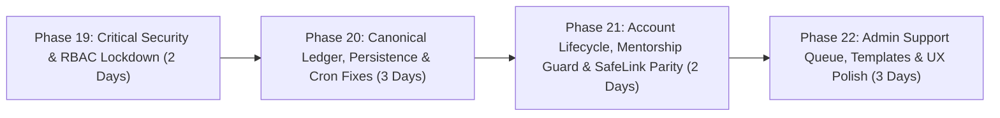

# TeamForge Post-Phase 18 Roadmap (Phases 19–22)

**Note**: Phases 6–18 in the earlier roadmap are **DONE** (38/42 original findings completely resolved; 4 partial items carried forward below alongside +18 newly audited items).

## Phase 19 — Critical Security, RBAC & Legacy Lockdown (Sprint 1, 2 Days)
- **`SEC-05`**: Lock `@Public() POST /users` to Super User; require passwords + rate limit on `POST /users/login`.
- **`SEC-06`**: Strictly whitelist editable fields in `SelfUpdateUserDto` (`PATCH /users/:id`), reset `emailVerified` on email change, lock `DELETE /users/:id` to Super User.
- **`SEC-07`**: Restrict `GET /users` and cross-user `GET /users/:id` to Admins/Super Users.
- **`SEC-08` & `SEC-09`**: Enforce `isProjectOwner` on `POST/DELETE /tasks`, `isProjectMember` on task comments, user ownership on `/notifications/:id`, and Admin-only on `POST /notifications`.
- **`SEC-10` & `SEC-11` & `SEC-12`**: Ban `image/svg+xml` + add image magic-byte checks, enforce `'mentor_apps'` for admin CV download/delete, retire legacy `/governance` & `/mentorship` policy bypasses, add `POST /admin/login` rate limiting, and attach `EmailVerifiedGuard` to invites/mentor-apps/reports.

## Phase 20 — Canonical Reputation Ledger, Persistence & Cron Fixes (Sprint 1, 3 Days)
- **`DAT-01` & `GAM-01`**: Unify `ReputationService` & `GamificationRepository` into ONE canonical ledger, fix startup double-seeding (`87 -> 174`), sync task/completion rep writes, and add minimum project age before completion badge award.
- **`DUR-01`**: Export & import `EscrowService`, `PlatformConfigService`, `PortalAdminsService`, `MentorApplicationsService`, `DemoUpiProvider`, and `JobRunsService` in `PersistenceService`.
- **`PRJ-07`**: Exclude `Draft` and `deletedAt` projects from `closeEmptyProjects`, `applyDeadlinePenalties`, and `reviewDeadlineJob`; count soft-deleted projects in 24h `PROJECT_DAILY_LIMIT`; close pending requests & `payment_pending` sessions on `softDeleteProject`.

## Phase 21 — Account Lifecycle, Mentorship Slots & `<SafeLink>` Parity (Sprint 2, 2 Days)
- **`PRJ-08`**: Release open/in-progress tasks & remove deleted collaborators from `collaborators[]` on `POST /users/me/delete`; remove user CV PDFs on disk; require fresh social auth token; match tasks strictly by `assigneeId` in `DataExportService`.
- **`MEN-06`**: Prevent mentor self-booking (`CANNOT_BOOK_SELF`), reject bookings on `Closed`/`Draft`/`deletedAt` projects, check overlapping `scheduledAt + durationMinutes` (`MENTOR_TIME_CONFLICT`), and inject `ClockService` into `DemoUpiProvider`.
- **`SEC-02`, `SEC-04`, `TSK-06`**: Replace the final 6 raw `<a href>` instances (`ProjectCard.jsx:250`, `AdminMentorApps.jsx:534`, `CollaboratorWorkspace.jsx:587`, `OwnedWorkspace.jsx:1377, 2116, 2214`) with `<SafeLink>`; extend `ContentFilterService` to task creation, comments, and mentor motivations.

## Phase 22 — Admin Support UI, Starter Templates & UX Polish (Sprint 2, 3 Days)
- **`ADM-03`**: Build `/admin/support` (`AdminSupport.jsx`) queue for Phase 12 `Project Closure Request` tickets and Help inquiries.
- **`PRJ-09`**: Category starter-task templates in `CreateProject.jsx` and optional `blockedByTaskId` task dependencies.
- **`MEN-07`**: Mentor weekly UTC/local availability slot selector in `MyMentorProfile.jsx` and `MentorsDirectory.jsx`.
- **`MOD-05` & `NOT-01`**: Job 19 `storageHygieneJob` (prune expired disk exports & orphan uploads, scrub >30d deleted tombstones), synchronous batch grouping for immediate task-release notifications, and unified ARIA/Escape modal accessibility.
